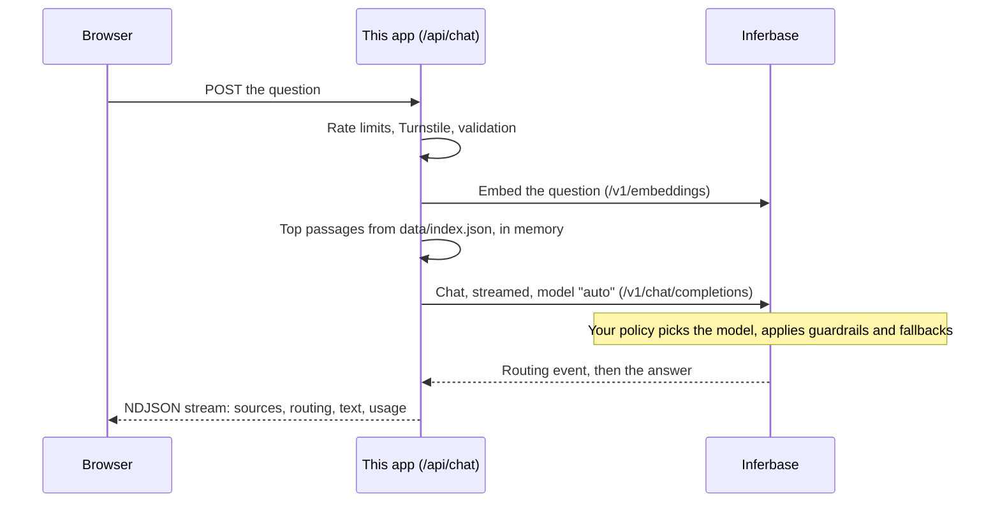

# Customer support agent

A support chat for your product that answers from your documentation, cites its sources, hands
off to a person when it should, and shows beside every answer which model Inferbase routed it to,
why, and what it cost.

One API key. No vector database, no cloud console, no model list to maintain.

The [customer support assistant build guide](https://inferbase.ai/solutions/customer-support-assistant)
explains the design, the routing policy and the security choices behind this app, with what was
measured. A live copy answers questions about Inferbase as the Copilot on
[inferbase.ai](https://inferbase.ai).

- **Answers from your docs.** `npm run index` reads your `llms-full.txt`, splits it into passages
  and embeds them through Inferbase. Each question retrieves the closest passages, and the answer
  cites them as [1], [2].
- **Routed per request.** The app sends `model: "auto"`. Your Inferbase routing policy decides
  which model answers each question, on quality, cost and latency, with fallbacks. Change the
  objective or the allowed models in the policy, not in this code.
- **A receipt under every answer.** The model chosen, the task it was classified as, the margin
  over the runner-up, the routing time, the cost and the documents used. Inferbase streams the
  routing decision as the first event of every answer; this app reads it.
- **Handoff to a person.** When someone asks for a human, is frustrated, or needs their account,
  the model ends its answer with a marker and the chat opens a form that emails the conversation to
  your support inbox, with the visitor as the reply-to.
- **Safe to put on a public site.** Per-visitor rate limits, an optional Cloudflare Turnstile check
  (passing it earns a signed one-hour session, and every message and handoff must carry one, so a
  bot cannot skip it by sending a made-up conversation), length limits, short answers, and the
  guardrails and daily spend cap you set on the API key in Inferbase.
- **Embeds anywhere.** One script tag adds a launcher to your site; the chat runs in a frame on its
  own origin.

## Run it

```bash
cp .env.example .env.local     # add INFERBASE_API_KEY
npm install
npm run index                  # build data/index.json from your docs
npm run dev                    # http://localhost:3000
```

The defaults index Inferbase's own documentation. Point `DOCS_SOURCE_URL` at your site's
`llms-full.txt` (and `DOCS_SOURCE_PREFIX` at the paths to index, comma-separated) to make it yours.

## Set up the API key in Inferbase

The app is a customer of the API like any other, so its safety settings live on its key:

1. **Create a key for this app** (API keys page). Give it a **daily spend cap**: a public chat
   box is an open endpoint, and the cap stops a runaway the same day.
2. **Attach a routing policy** with the objective you want (for example `balanced`) and the models
   you allow.
3. **Name a guardrail policy** in that routing policy, with prompt-injection checks on the input.
   A message that trips it is refused before any model sees it, and the visitor is asked to
   rephrase.

Requests from the app are labelled `X-Inferbase-Source: support-agent` (set `INFERBASE_SOURCE`
to change it), so they are easy to find in your logs.

## Add it to your site

```html
<script src="https://YOUR-DEPLOYMENT/embed.js" data-label="Ask a question" async></script>
```

Set `FRAME_ANCESTORS=https://your-site.com` on the deployment so your site may frame it. Raise the
launcher above a cookie banner with `data-bottom="96"`.

## Account mode: answers about the signed-in person's own account

Inside your own portal, the assistant can also look things up for the person using it: their
recent requests and why one failed, how a request was routed, what they spent and on which models,
their API keys, their connections, their policies. It can read and never change anything.

It runs on a credential made for this: a read-only token, which your portal mints from the person's
signed-in session (`POST /api/v1/users/access-tokens/read-only`). The token lasts ten minutes, can
only make GET requests to the account endpoints the tools use, and ends when that session signs out.
The browser passes it to this app per request; the app uses it for the account lookups only and
never stores or logs it. Your own API key still pays for the answers, and the two never mix.

1. Set `ACCOUNT_PARENT_ORIGINS=https://your-portal.com` (the pages allowed to hand over a token) and
   add that origin to `FRAME_ANCESTORS`. Optionally set `INFERBASE_ACCOUNT_API_KEY` to a second key
   with its own daily cap.
2. In your portal, frame `https://YOUR-DEPLOYMENT/?embed=1&account=1` for signed-in people, and
   answer the frame's request for a token:

```ts
window.addEventListener('message', async (event) => {
  // Only your own frame, at the assistant's origin.
  if (event.origin !== ASSISTANT_ORIGIN || event.source !== frame.contentWindow) return
  if (event.data?.type !== 'inferbase:ready') return
  const { token, expires_at } = await mintReadOnlyToken() // POST /api/v1/users/access-tokens/read-only, as the signed-in person
  // first_name is optional: the greeting uses it ("Hi Vishal") and nothing else does.
  frame.contentWindow.postMessage({ type: 'inferbase:token', token, expires_at, first_name }, ASSISTANT_ORIGIN)
})
```

The frame asks again a minute before the token expires, and when the API refuses it. Without a
token it answers from the documentation only, exactly as on a public page.

Tool results are untrusted text, like any page the model reads: they pass the key's tool-output
guardrail before the model sees them, and the prompt treats them as data. Each tool returns only the
fields an answer needs (`lib/account-tools.ts`), capped in size.

## Check the answers

```bash
npm run eval -- --retrieval-only   # does each question find the right page (embeddings only)
npm run eval                       # full answers: facts, refusals off-topic, handoff
npm run eval -- --account          # account mode, against the made-up account in evals/account.json
```

Account mode is measured without a real account or a token: the chat route's own answer loop
(`lib/answer.ts`) runs with the account tools reading `evals/account.json`, a made-up account whose
figures appear nowhere else, so a right answer can only come from the tools. Each case names the
lookups it expects and the facts the answer must, and must not, contain.

The questions are in `evals/questions.json`. Replace them with real questions your customers ask,
each with the page that answers it. Run the evaluation after every change to the docs, the prompt
or the routing policy.

## How it works



| File | What it does |
|---|---|
| `lib/inferbase.ts` | The OpenAI SDK pointed at Inferbase: the whole integration |
| `lib/docs.ts` | Splits an llms-full.txt into passages |
| `lib/retrieval.ts` | Loads the index, embeds the question, returns numbered sources |
| `lib/prompt.ts` | The system prompt: answer from the passages, cite, refuse off-topic, hand off |
| `lib/events.ts` | Reads Inferbase's routing and usage events from the stream |
| `lib/account-tools.ts` | Account mode: the read-only lookups, each one GET with the person's token |
| `lib/account-token.ts` | Account mode: the token handshake with the portal that frames the app |
| `lib/rate-limit.ts` | Per-visitor limits (in memory; implement `Limiter` on Redis for several instances) |
| `lib/answer.ts` | One answer: the model call, and in account mode the lookups it asks for |
| `app/api/chat/route.ts` | Checks the visitor, retrieves the passages, streams the answer |
| `app/api/handoff/route.ts` | Emails the conversation to your support inbox |
| `public/embed.js` | The launcher for your site |

## Limits worth knowing

- The rate limiter counts per server instance. On serverless or several instances, back it with a
  shared store. The daily spend cap on the key is the limit that holds regardless.
- Retrieval is in memory, which suits a documentation site (hundreds to a few thousand passages).
  For a much larger corpus, move the vectors to a vector store; the rest of the app is unchanged.
- Answers are generated. The prompt keeps them to the passages and the evaluation checks them,
  but they can still be wrong; the chat says so.

## License

Apache-2.0.
